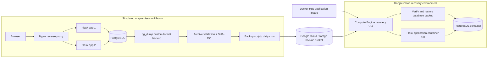

# HybridMod — Hybrid Application Backup & Disaster Recovery

HybridMod is a hands-on hybrid-cloud disaster-recovery project that simulates an on-premises application on a local Ubuntu machine and recovers it on Google Cloud after an outage.

The local environment runs a Flask application and PostgreSQL in Docker Compose, with Nginx routing requests across two Flask instances. PostgreSQL backups are validated, checksummed, and uploaded to Google Cloud Storage (GCS). A Docker image is published to Docker Hub, while Terraform provisions a Google Compute Engine recovery VM with limited read access to the backup bucket. During recovery, the VM pulls the application image, verifies and downloads the latest database backup, restores PostgreSQL, and starts the application.

> **Lab scope:** The local Ubuntu machine represents the on-premises environment. Backups are periodic, not live replication, and recovery is initiated by running the recovery script. This is a disaster-recovery lab rather than an automatic failover service.

## Architecture



## Features

- **Containerized local stack:** Flask, PostgreSQL, and Nginx managed with Docker Compose.
- **Application resilience:** Two local Flask instances behind Nginx.
- **Database backup:** Custom-format PostgreSQL dump created with `pg_dump`.
- **Backup integrity:** Archive validation and SHA-256 checksum verification before recovery.
- **Cloud backup storage:** Backups and checksum files uploaded to a private GCS bucket.
- **Scheduled backups:** Daily cron job on the local machine.
- **Container image distribution:** Application image published to Docker Hub.
- **Infrastructure as Code:** Terraform provisions the Compute Engine VM, firewall rule, dedicated service account, and bucket-level read-only access.
- **Recovery workflow:** Download the latest backup, verify it, restore PostgreSQL, and launch the application on the recovery VM.
- **Persistence checks:** Database records were verified after local and cloud application restarts.

## Technology Stack

| Area | Technologies |
|---|---|
| Application | Python, Flask, Gunicorn |
| Database | PostgreSQL |
| Containers | Docker, Docker Compose |
| Local routing | Nginx |
| Backup and integrity | `pg_dump`, `pg_restore`, SHA-256 |
| Cloud object storage | Google Cloud Storage |
| Recovery compute | Google Compute Engine |
| Infrastructure as Code | Terraform, Google Cloud provider |
| Image registry | Docker Hub |
| Automation | Bash, cron, gcloud CLI |

## Repository Structure

```text
hybridmod/
├── app/
│   ├── app.py
│   ├── Dockerfile
│   └── requirements.txt
├── nginx/
│   └── nginx.conf
├── scripts/
│   ├── backup.sh
│   └── recover-vm.sh
├── terraform/
│   ├── providers.tf
│   ├── main.tf
│   ├── variables.tf
│   └── terraform.tfvars       
├── backups/                   
├── restore-test/              
├── compose.yaml
├── .dockerignore
└── .gitignore
```

## Prerequisites

- Ubuntu/Linux with Docker Engine and Docker Compose plugin.
- Google Cloud project with billing enabled and permission to manage Compute Engine, IAM, and Cloud Storage resources.
- Google Cloud CLI (`gcloud`) authenticated for the project.
- Terraform installed.
- A private GCS bucket for database backups.
- A Docker Hub image containing the HybridMod application.

Commands below assume the project ID is `hybridmod`, the bucket is `hybridmod-db-backups_rt`, the region is `asia-south1`, and the zone is `asia-south1-a`. Update them if your environment differs.

## 1. Run the Local Application

From the project root, create a local `.env` file with a strong PostgreSQL password. The Compose configuration reads this value:

```bash
printf 'POSTGRES_PASSWORD=%s\n' 'replace-with-a-strong-password' > .env
chmod 600 .env
```

Use your own password rather than the example placeholder. Keep `.env` out of Git.

Build and start the local stack:

```bash
docker compose up -d --build
docker compose ps
```

Open the application at [http://localhost:8080](http://localhost:8080). Check the health endpoint:

```bash
curl http://localhost:8080/health
```

Add a few records in the Operations Logbook to use as recovery-test data.

> **Persistence note:** `docker compose down` preserves the named database volume. Do not use `docker compose down -v` unless you intentionally want to delete local database data.

## 2. Create and Upload a Database Backup

Run the backup script from the project root:

```bash
chmod +x scripts/backup.sh
./scripts/backup.sh
```

The script checks that PostgreSQL is ready, creates a timestamped custom-format dump, validates the archive, creates a SHA-256 checksum, and uploads both files to the configured GCS bucket. The default bucket is `hybridmod-db-backups_rt`; the script supports overriding it with `GCS_BUCKET` if configured that way in the script:

```bash
GCS_BUCKET=your-backup-bucket ./scripts/backup.sh
```

List the cloud objects:

```bash
gcloud storage ls -l gs://hybridmod-db-backups_rt/
```

### Restore validation

A backup should be treated as useful only after it has been validated. HybridMod's workflow checks the archive and checksum, and the local restore test used a separate test database so the primary database was not overwritten. Repeat restore tests against a separate database when changing the backup logic.

## 3. Scheduled Backups

A daily cron job is configured to run the backup script at **02:00 local time** and append output to `backups/backup-cron.log`.

Check the installed schedule and recent logs:

```bash
crontab -l
tail -n 50 backups/backup-cron.log
```

The local computer must be powered on, awake, connected to the network, and able to access Docker and GCS when cron runs. If the machine is off at the scheduled time, the backup may be skipped. For a production-like design, run backups from a continuously available host or managed scheduler and configure retention/lifecycle rules.

## 4. Publish the Application Image

Build and push a versioned image to your own Docker Hub repository. Replace `YOUR_DOCKERHUB_USERNAME` with your username:

```bash
docker build -f app/Dockerfile \
  -t YOUR_DOCKERHUB_USERNAME/hybridmod:v1.0.0 .

docker login -u YOUR_DOCKERHUB_USERNAME
docker push YOUR_DOCKERHUB_USERNAME/hybridmod:v1.0.0
```

Use the exact published image name and tag when running the recovery script. Ensure the build context excludes `.env`, backups, restore-test files, and other local data. The example recovery workflow expects the image to be publicly pullable by the VM; private images require registry authentication configured securely.

## 5. Provision the Recovery VM with Terraform

Authenticate the Google Cloud CLI and configure Application Default Credentials:

```bash
gcloud config set project hybridmod
gcloud auth login
gcloud auth application-default login
gcloud services enable compute.googleapis.com
```

Review `terraform/terraform.tfvars` and confirm the project, zone, and backup bucket values. This file is local configuration and should not be committed.

Initialize and review the proposed resources:

```bash
cd terraform
terraform init
terraform validate
terraform plan
```

If the plan is correct, create the infrastructure:

```bash
terraform apply
```

Confirm with `yes` when Terraform asks. The configuration provisions a Compute Engine recovery VM, a dedicated service account, bucket-level read-only access for that account, and an HTTP firewall rule for the demo. Record the public IP shown in Terraform output.

**Cost and exposure:** The VM, disk, and public IP may incur charges. HTTP is unencrypted and the demo endpoint is publicly reachable. Do not use this configuration as-is for sensitive production workloads.

## 6. Run the Cloud Recovery Procedure

From the repository root, copy the recovery script to the VM. Replace the project, zone, and image values if yours differ:

```bash
gcloud compute scp scripts/recover-vm.sh \
  hybridmod-recovery-vm:~/recover-vm.sh \
  --zone=asia-south1-a \
  --project=hybridmod
```

Run the script on the VM with the exact Docker Hub image you published:

```bash
gcloud compute ssh hybridmod-recovery-vm \
  --zone=asia-south1-a \
  --project=hybridmod \
  --command="sudo bash ~/recover-vm.sh 'YOUR_DOCKERHUB_USERNAME/hybridmod:v1.0.0'"
```

The recovery script installs the required container runtime, pulls the application image, uses the VM's attached service account to read the backup bucket, downloads the newest dump and its checksum, verifies the checksum and archive, starts PostgreSQL, restores the dump, and starts the Flask application.

After successful recovery, open `http://<recovery-vm-public-ip>/` and check `http://<recovery-vm-public-ip>/health`. Verify that records from the latest backup are visible and that the application accepts new records. Restarting the application container and checking the records again provides a basic persistence test.

## 7. Disaster-Recovery Test

A useful project demonstration is:

1. Add recognizable records to the local app.
2. Run the backup script and verify the dump and checksum exist in GCS.
3. Stop the local application stack to simulate the local application outage:

   ```bash
   docker compose stop
   ```

4. Run the recovery procedure on the Compute Engine VM.
5. Open the cloud recovery URL and confirm the backed-up records are present.
6. Create a new record, restart the application container, and confirm database records persist.

The backup is a point-in-time snapshot. Records created locally after the last successful backup will not be present in the restored environment.

## Security Notes

- Keep `.env`, backup files, restore-test files, Terraform state, and local `terraform.tfvars` out of version control.
- The recovery VM uses a dedicated service account with the `Storage Object Viewer` role scoped to the backup bucket, rather than broad project-level storage access.
- The PostgreSQL container is not directly published to the internet; the recovery application connects to it over a Docker network.
- The demo uses plain HTTP and has no application authentication. Restrict access or add HTTPS and authentication before exposing it beyond a controlled demonstration.
- Consider backup retention, encryption requirements, audit logging, monitoring, and periodic restore drills before adapting this lab for a real environment.

## Limitations and Future Improvements

- **Point-in-time recovery only:** Backups are periodic full dumps, not continuous replication; recent writes after the most recent backup may be lost.
- **Local scheduling dependency:** The scheduled job runs on the local Ubuntu machine and depends on it being online.
- **Manual recovery trigger:** Recovery is initiated by an operator running the script; health-based automatic failover is not implemented.
- **Single recovery VM:** The cloud environment is a demonstration recovery target, not a highly available production architecture.
- **HTTP-only demo:** Add HTTPS, access controls, and secret management before production use.
- **Retention policy:** Configure lifecycle/retention rules to control storage growth and avoid keeping every backup indefinitely.
- **Operational hardening:** Add monitoring, alerting, repeatable restore drills, and a secure remote Terraform state backend for team use.

## Cleanup

To avoid ongoing Compute Engine charges, destroy the Terraform-managed recovery resources when you no longer need the demonstration:

```bash
cd terraform
terraform destroy
```

Review the proposed deletions and type `yes` to confirm. The GCS bucket was created separately and is not deleted by this Terraform configuration, so your backup objects should remain. Review the bucket and other Google Cloud resources separately to ensure no unwanted charges remain.

---

**Project:** HybridMod — On-Premises Application Backup & Cloud Disaster Recovery  
**Environment:** Ubuntu home lab + Google Cloud  
**Purpose:** Demonstrate containerized application deployment, cloud backup, Infrastructure as Code, and tested database recovery.
